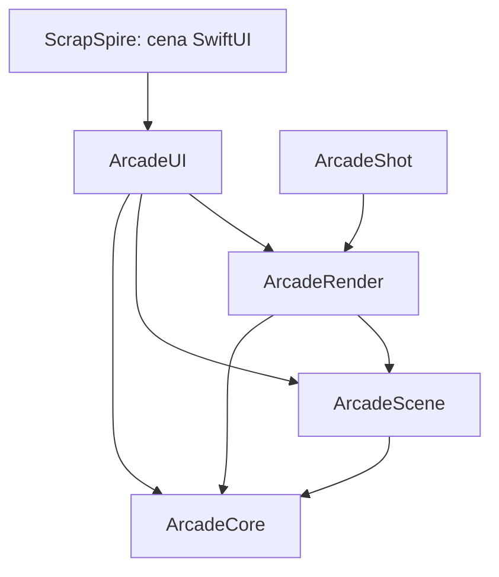

# Arquitetura

Notas de implementação do Scrap Spire. O README cobre o porquê das três exigências (responsivo,
4K com upscaling, 60 fps travado); aqui está como o código se organiza e por quê.

## Camadas

| Target | Responsabilidade | Depende de |
| --- | --- | --- |
| `ArcadeCore` | Simulação pura: geometria, relógio de passo fixo, viewport virtual, nível, física do personagem, obstáculos, pontuação, arte em pixels. Sem SpriteKit, Metal ou SwiftUI | nada |
| `ArcadeScene` | Grafo SpriteKit espelhado do estado do núcleo; fábrica de texturas a partir das grades de pixels | Core |
| `ArcadeRender` | Pipeline Metal: `FrameComposer`, `SpatialUpscaler` (MetalFX), shader CRT, `GameRenderer` (`MTKViewDelegate`), `FrameGrabber` headless | Core, Scene |
| `ArcadeUI` | `GameSession` (`@MainActor @Observable`), host `MTKView`, HUD, controles de toque e teclado, ajustes | Core, Scene, Render |
| `ArcadeShot` | Executável que renderiza um frame para PNG sem janela | Core, Scene, Render |

A regra que sustenta o resto: **toda regra de jogo mora no `ArcadeCore`**, que não importa
framework nenhum. É por isso que a suíte roda em milissegundos e que a simulação é determinística.

## O laço de frame

`GameRenderer.draw(in:)` roda na main thread (o `MTKView` chama assim por padrão; o delegate é
`nonisolated` e entra em `MainActor.assumeIsolated`).

1. Mede o drawable e monta a `VirtualViewport` a partir dos **pontos** da view e da safe area.
2. `GameSession.advance(to:viewport:)` aplica a viewport na cena, roda `GameClock` e executa de 0 a
   5 passos fixos de simulação, drena os eventos e sincroniza o grafo SpriteKit.
3. `FrameComposer.compose(...)` faz a cena → offscreen → MetalFX → CRT → drawable.
4. O relatório do frame (resolução interna, de saída, se o MetalFX entrou) volta para a `GameSession`
   e aparece na tela de ajustes.

O input é coletado num `InputBuffer` e consumido **uma vez por frame**. Quando um frame gera vários
passos, o pulo e o start valem só no primeiro, senão um frame longo viraria pulo duplo.

## tvOS

O Apple TV é o alvo principal. O que muda:

- **Entrada.** `GamepadInput` (ArcadeUI) faz *polling* de `GCController` a cada frame e alimenta o
  mesmo `InputBuffer` do teclado e do stick na tela. A decisão fica em `GamepadMapping`
  (ArcadeCore), puro e testado: zona morta, clamp de stick + d-pad somados, e **uma** borda de pulo
  por pressionada. Sem isso, segurar o botão viraria pulo a 60 Hz.
- **Qualquer botão inicia.** A borda de pulo também emite `start`, então não é preciso ter um botão
  focado para começar — o que importa porque o motor de foco do tvOS é a única forma de "clicar".
- **Foco versus jogo.** Um controle focável no tvOS captura o d-pad do Siri Remote. Por isso o botão
  de ajustes some enquanto `phase.isInteractive`, deixando o remote inteiro para o jogo.
- **`Slider` não existe no tvOS.** Os controles de CRT caem num `Picker` de quatro passos, navegável
  por foco. `DragGesture` também não existe, então `TouchControlsView` inteiro está sob `#if os(iOS)`
  — não basta não usá-lo, o arquivo precisa não compilar.
- **Overscan.** É só safe area: o tvOS reporta as margens por `safeAreaInsets`, que a
  `VirtualViewport` já usa para encaixar a área de jogo. Nada de constante mágica de overscan.

O simulador de tvOS não traz MetalFX (o SDK do device traz), então lá o jogo exercita o caminho de
resolução nativa.

### Diagnóstico de frame

`GameRenderer` imprime, em `DEBUG`, a cada 120 frames: contagem, drawables perdidos, tamanho do
drawable, bounds e fps alvo. Foi o que resolveu a dúvida de o `simctl io screenshot` do tvOS
devolver sempre a mesma imagem: o log mostrou `frames=720 missingDrawable=0 drawableSize=3840x2160`,
provando que o jogo apresentava 60 fps em 4K e que a captura é que estava em cache.

## Decisões

- **`SKRenderer` em vez de `SKView`.** É o único jeito de colocar SpriteKit dentro de um pipeline
  Metal próprio. Sem isso não há MetalFX nem post-processing.
- **`scaleMode = .fill`.** `.resizeFill` faz o SpriteKit redimensionar a cena para o viewport, o que
  desalinha o mapeamento e faz o culling descartar o grafo inteiro (o sintoma foi um frame todo na
  cor de limpeza). Como a `VirtualViewport` garante que a área visível tem exatamente o aspecto da
  tela, `.fill` é exato e não distorce.
- **Tolerância no acumulador do relógio.** Somar deltas em ponto flutuante deixa o acumulador um fio
  abaixo do tick e um display de 120 Hz perde um passo por segundo. A comparação usa `1e-9` de
  folga, 60 mil vezes menor que um tick.
- **Arte como grade de pixels no código.** Sem assets externos, sem binários no repositório, e os
  testes conferem que cada sprite é retangular, tem pixels visíveis e índices válidos na paleta.
- **Cap de saída em 4K.** Acima disso o custo cresce sem ganho perceptível; a imagem é esticada do
  render 4K para o drawable na passada de CRT.
- **`canImport(MetalFX)`.** O SDK do simulador iOS não traz o framework. O guard mantém o simulador
  compilando e o jogo cai para resolução nativa, o mesmo caminho usado quando
  `supportsDevice` é falso.

## O que ainda não existe

- Som e háptica (os eventos do mundo já existem e são o ponto de ligação).
- Suporte a controle físico via `GameController`.
- Persistência do recorde entre sessões.
- `MTLFXTemporalScaler`, que renderiza ainda mais baixo com qualidade melhor, mas exige vetores de
  movimento e buffer de profundidade — a cena 2D teria que produzi-los.
